# Self-Hosted Hybrid RAG & Re-ranking Engine

A production-ready, modular, and self-hosted **Hybrid RAG & Re-ranking Engine** built with **FastAPI**, backed by **Qdrant Vector Database** (via Docker container or embedded mode), **BM25 sparse keyword search**, **Semantic Chunking**, **Anthropic Contextual Retrieval**, and a **Cross-Encoder Re-ranker**.

---

## Key Features

1. **Interactive Frontend Web Dashboard**:
   - Built-in single-page application served directly by FastAPI at `http://localhost:8000/`.
   - **Zero-build setup**: Uses modern Tailwind CSS and glassmorphism styling via CDN — no Node.js or npm needed.
   - Four dedicated studios:
     - **Hybrid Search Studio**: Real-time slider controls (dense/sparse weights, $k_{rrf}$, top-k), Cross-Encoder re-rank toggle, stage-by-stage latency breakdowns, and rich cards highlighting Anthropic contextual summaries.
     - **Ingestion & Chunking Studio**: Form with pre-loaded presets (Robotics, Finance), chunking strategy toggles (semantic vs sliding window), and live chunk previews.
     - **Cross-Encoder Playground**: Compare query vs multiple arbitrary passages with immediate relevance logits.
     - **Collections & System Monitor**: Live vector counts, dimension stats, hardware accelerator badges (CUDA/GPU), and one-click deletion.

2. **Dockerized Qdrant Vector DB**:
   - Containerized deployment using official `qdrant/qdrant:v1.12.0` with persistent volume storage.
   - Built-in **Qdrant Web UI Dashboard** accessible at `http://localhost:6333/dashboard` for visual vector inspection.
   - Supports both containerized REST/gRPC connection and graceful embedded fallback for zero-dependency development.

3. **Advanced Semantic Chunking**:
   - Analyzes consecutive sentence embeddings (`BAAI/bge-small-en-v1.5`) and calculates cosine distances.
   - Uses dynamic percentile-based breakpoint detection to split text where semantic context shifts.
   - Preserves topic integrity unlike arbitrary fixed-size chunking.

3. **Anthropic Contextual Retrieval**:
   - Implements Anthropic's breakthrough contextual retrieval technique: generates situational summaries (50–100 tokens) situating each chunk within the overall document context.
   - Situational summary is prepended (`<summary>\n\n<chunk_text>`) before both dense embedding and BM25 sparse indexing.
   - Multi-provider support:
     - **Anthropic Claude** (`claude-3-5-haiku` / `claude-3-haiku` via `ANTHROPIC_API_KEY`)
     - **OpenAI / Ollama / Local LLM** (via `OPENAI_API_BASE` / `OLLAMA_BASE_URL`)
     - **Zero-Key Offline Heuristic Fallback** (TF-IDF keyword & document centrality) running 100% locally out-of-the-box.

4. **Hybrid Retrieval (Dense + BM25)**:
   - **Dense Search**: Cosine similarity in high-dimensional vector space on Qdrant.
   - **Sparse Search**: BM25Okapi keyword search with stopword filtering and persistent index storage.
   - **Fusion Strategies**:
     - **Reciprocal Rank Fusion (RRF)**:
       $$RRF(d) = \sum_{m \in \{dense, bm25\}} \frac{w_m}{k + \text{rank}_m(d)}$$
     - **Relative Score Fusion (RSF)**: Min-max normalized linear combination.

5. **Cross-Encoder Re-ranking**:
   - Top candidate chunks from hybrid fusion are passed to a Cross-Encoder (`cross-encoder/ms-marco-MiniLM-L-6-v2`).
   - Computes full joint self-attention across query and passage tokens to accurately capture fine-grained relevance and resolve dense/sparse retrieval disagreements.

---

## Architecture Diagram

```mermaid
flowchart TD
    subgraph Ingestion Pipeline
        Doc[Raw Document] --> SC[Semantic Chunker]
        SC --> Chunks[Raw Chunks]
        Doc -. Document Context .-> CR[Anthropic Contextual Summarizer]
        Chunks --> CR
        CR --> CChunks["Contextualized Chunks\n(Summary + Chunk)"]
        CChunks --> Embed[Dense Embedding Model\nBAAI/bge-small-en-v1.5]
        CChunks --> BM25Index[Sparse BM25 Indexer\nrank-bm25]
        Embed --> Qdrant[(Qdrant Docker Container\nPort 6333)]
        BM25Index --> BM25Store[(Persistent BM25 Store)]
    end

    subgraph Search & Re-ranking Pipeline
        Query[Search Query] --> QEmbed[Query Embedding]
        Query --> QToken[Query Tokenizer]
        QEmbed --> QdrantSearch[Qdrant Dense Search]
        QToken --> BM25Search[BM25 Sparse Search]
        QdrantSearch --> DenseHits[Top-K Dense Hits]
        BM25Search --> SparseHits[Top-K Sparse Hits]
        DenseHits --> Fusion[Reciprocal Rank Fusion]
        SparseHits --> Fusion
        Fusion --> Candidates[Top-N Candidates Pool]
        Candidates --> Reranker[Cross-Encoder Re-ranker\nms-marco-MiniLM-L-6-v2]
        Query -. (Query, Candidate) .-> Reranker
        Reranker --> FinalRanked[Final Top-K Ranked Results]
    end
```



---

## Quickstart Guide

### 1. Start Qdrant with Docker

You can launch Qdrant as a Docker container with persistent volume storage:

```powershell
# Option A: Using the provided helper script
.\scripts\start_qdrant_docker.ps1

# Option B: Using docker run directly
docker run -d --name qdrant-hybrid-rag -p 6333:6333 -p 6334:6334 -v qdrant_storage:/qdrant/storage qdrant/qdrant:v1.12.0
```

Once running:
- **REST API**: `http://localhost:6333`
- **Qdrant Web Dashboard**: `http://localhost:6333/dashboard`

### 2. Run Everything with Docker Compose (1 Single Command)

To run the complete 3-tier system (React Frontend + FastAPI Engine + Qdrant Vector DB) in harmony:

```bash
docker compose up -d
```

Once running, access:
- **React Frontend Application**: [http://localhost:3000](http://localhost:3000)
- **FastAPI Swagger API Documentation**: [http://localhost:8000/docs](http://localhost:8000/docs)
- **Qdrant Vector DB & Web Dashboard**: [http://localhost:6333/dashboard](http://localhost:6333/dashboard)

### 3. Local Development Setup (Without Docker)

```powershell
# Install dependencies
pip install -r requirements.txt

# Copy environment template
copy .env.example .env

# Run FastAPI server with auto-reload
uvicorn app.main:app --host 0.0.0.0 --port 8000 --reload
```

---

## Running the Automated Tests & Demo

### Run Test Suite
```powershell
pytest tests/test_engine.py -v
```

### Run Interactive Demonstration
```powershell
python demo_client.py
```

---

## API Reference

### 1. Ingest Documents
**`POST /api/v1/ingest`**

Chunks text, generates Anthropic Contextual Retrieval summaries, and indexes into Qdrant & BM25.

**Request Body:**
```json
{
  "collection_name": "tech_docs",
  "chunking_strategy": "semantic",
  "use_contextual_retrieval": true,
  "context_provider": "heuristic",
  "documents": [
    {
      "id": "acme_doc_01",
      "title": "Acme Robotics Architecture",
      "text": "Acme Robotics manufactures autonomous warehouse robots. The robots utilize graph-based SLAM algorithms with LiDAR and IMU sensor fusion. The powertrain operates on LiFePO4 batteries offering 18 hours of autonomy with 35-minute fast charging.",
      "metadata": {
        "author": "Engineering Team",
        "category": "Robotics"
      }
    }
  ]
}
```

**Response:**
```json
{
  "collection_name": "tech_docs",
  "documents_ingested": 1,
  "chunks_created": 2,
  "duration_ms": 142.5,
  "message": "Documents successfully chunked, contextualized, and indexed.",
  "sample_chunks": [
    {
      "chunk_id": "8a32bc...",
      "doc_id": "acme_doc_01",
      "chunk_index": 0,
      "raw_text": "Acme Robotics manufactures autonomous warehouse robots...",
      "context_summary": "[Context: This passage belongs to 'Acme Robotics Architecture'...",
      "contextualized_text": "[Context: This passage belongs to 'Acme Robotics Architecture'...\n\nAcme Robotics manufactures...",
      "metadata": {"category": "Robotics"}
    }
  ]
}
```

---

### 2. Hybrid Search & Re-ranking
**`POST /api/v1/search`**

Executes dense vector search and BM25 sparse search, fuses results with Reciprocal Rank Fusion, and scores with the Cross-Encoder.

**Request Body:**
```json
{
  "collection_name": "tech_docs",
  "query": "How long do the batteries last and what is the charging time?",
  "top_k": 3,
  "dense_top_k": 10,
  "sparse_top_k": 10,
  "fusion_method": "rrf",
  "rrf_k": 60,
  "dense_weight": 0.5,
  "sparse_weight": 0.5,
  "apply_reranking": true
}
```

**Response:**
```json
{
  "query": "How long do the batteries last and what is the charging time?",
  "collection_name": "tech_docs",
  "total_dense_candidates": 2,
  "total_sparse_candidates": 2,
  "total_fused_candidates": 2,
  "results": [
    {
      "chunk_id": "8a32bc...",
      "doc_id": "acme_doc_01",
      "chunk_index": 1,
      "text": "The powertrain operates on LiFePO4 batteries offering 18 hours of autonomy with 35-minute fast charging.",
      "context_summary": "[Context: This passage belongs to 'Acme Robotics Architecture'...",
      "dense_rank": 1,
      "dense_score": 0.8124,
      "bm25_rank": 1,
      "bm25_score": 4.128,
      "fusion_rank": 1,
      "fusion_score": 0.01639,
      "cross_encoder_score": 6.845,
      "final_score": 6.845,
      "metadata": {"category": "Robotics"}
    }
  ],
  "timing_ms": {
    "dense_retrieval_ms": 12.4,
    "sparse_retrieval_ms": 1.2,
    "fusion_ms": 0.3,
    "reranking_ms": 14.8,
    "total_ms": 28.7
  }
}
```

---

### 3. Standalone Cross-Encoder Re-ranker
**`POST /api/v1/rerank`**

**Request Body:**
```json
{
  "query": "electric vehicles battery range",
  "documents": [
    {"id": "doc_1", "text": "A standard chocolate chip cookie recipe with brown sugar."},
    {"id": "doc_2", "text": "Modern lithium-ion EV battery packs deliver upwards of 350 miles of highway range on a single charge."}
  ],
  "top_k": 2
}
```

---

### 4. Health & Hardware Status
**`GET /api/v1/health`**

Returns connectivity to Qdrant Docker container, hardware accelerators (CUDA/CPU), loaded model versions, and contextual provider.

---

## Configuration (`.env`)

| Variable | Default | Description |
|---|---|---|
| `QDRANT_URL` | `http://localhost:6333` | Docker Qdrant URL |
| `QDRANT_LOCAL_PATH` | `./data/qdrant_storage` | Local embedded fallback storage path |
| `BM25_STORAGE_DIR` | `./data/bm25_indexes` | Directory where BM25 indices are persisted |
| `EMBEDDING_MODEL` | `BAAI/bge-small-en-v1.5` | Dense embedding model |
| `CROSS_ENCODER_MODEL` | `cross-encoder/ms-marco-MiniLM-L-6-v2` | Cross-encoder re-ranking model |
| `CONTEXTUAL_RETRIEVAL_PROVIDER` | `heuristic` | `heuristic`, `anthropic`, `openai`, or `ollama` |
| `ANTHROPIC_API_KEY` | - | Required if provider is set to `anthropic` |
| `OPENAI_API_KEY` | - | Required if provider is set to `openai` |
| `OLLAMA_BASE_URL` | `http://localhost:11434` | URL if provider is set to `ollama` |
| `DEFAULT_RRF_K` | `60` | Smoothing factor for Reciprocal Rank Fusion |
| `DEFAULT_DENSE_WEIGHT` | `0.5` | Dense retrieval contribution in fusion |
| `DEFAULT_SPARSE_WEIGHT` | `0.5` | BM25 retrieval contribution in fusion |

---

## License
MIT License

