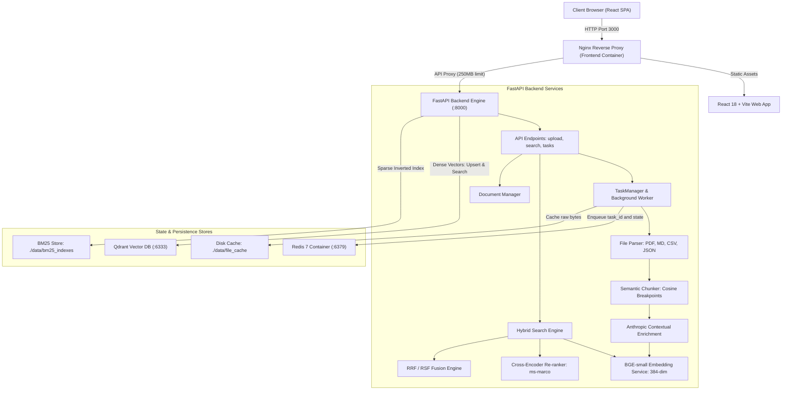
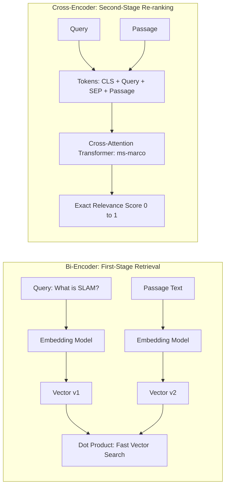
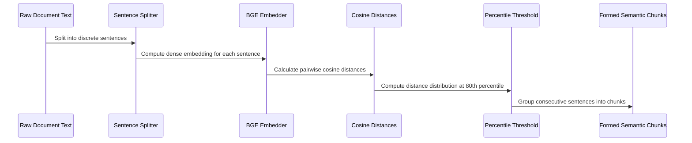
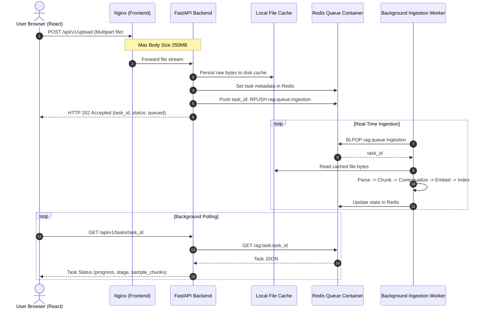
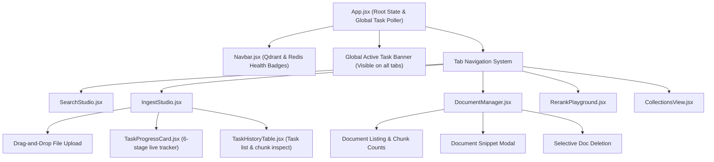

# Comprehensive Deep-Dive Walkthrough: Self-Hosted Hybrid RAG & Re-ranking Engine

A production-grade, enterprise-ready, self-hosted **Hybrid RAG (Retrieval-Augmented Generation) & Re-ranking Engine** featuring:
- **4-Tier Containerized Architecture** via Docker Compose (FastAPI Backend, React + Vite Frontend, Qdrant Vector DB, Redis Task Queue).
- **Dense Semantic Embeddings** (`BAAI/bge-small-en-v1.5`, 384 dimensions).
- **Sparse Lexical Search** via **BM25Plus** with custom tokenization, stopword filtering, and persistent disk indexes.
- **Hybrid Fusion Engine** combining Dense and Sparse result lists via **Reciprocal Rank Fusion (RRF, \(k=60\))** and **Relative Score Fusion (RSF)**.
- **Cross-Encoder Re-ranking** (`cross-encoder/ms-marco-MiniLM-L-6-v2`) with full token-level joint cross-attention.
- **Semantic Chunking** with sentence embedding cosine distance breakpoint detection and adaptive percentile thresholding.
- **Anthropic Contextual Retrieval** prepending situational document context summaries before indexing.
- **2-Step Resilient Ingestion Pipeline with Redis Task Queue** providing instant raw-file caching, asynchronous background execution, and live stage tracking.
- **Global Tab-Persistent Frontend State** preventing loss of ongoing ingestion tasks when switching tabs.
- **Granular Document Management** supporting multi-format uploads (.pdf, .md, .txt, .csv, .json) and single-document deletion without dropping collections.

---

## Table of Contents
1. [Architecture Overview & System Topology](#1-architecture-overview--system-topology)
2. [Core Theoretical Concepts & Mathematical Foundations](#2-core-theoretical-concepts--mathematical-foundations)
   - [A. Dense Vector Embeddings & Semantic Search](#a-dense-vector-embeddings--semantic-search)
   - [B. Sparse Lexical Search & BM25Plus](#b-sparse-lexical-search--bm25plus)
   - [C. Hybrid Fusion: Reciprocal Rank Fusion (RRF) vs Relative Score Fusion (RSF)](#c-hybrid-fusion-reciprocal-rank-fusion-rrf-vs-relative-score-fusion-rsf)
   - [D. Cross-Encoder Joint Attention Re-ranking](#d-cross-encoder-joint-attention-re-ranking)
   - [E. Semantic Chunking with Adaptive Breakpoint Detection](#e-semantic-chunking-with-adaptive-breakpoint-detection)
   - [F. Anthropic Contextual Retrieval Architecture](#f-anthropic-contextual-retrieval-architecture)
3. [The 2-Step Ingestion & Redis Queue Architecture](#3-the-2-step-ingestion--redis-queue-architecture)
   - [Why Synchronous Ingestion Fails on Large Files](#why-synchronous-ingestion-fails-on-large-files)
   - [Step 1: Instant Raw File Caching](#step-1-instant-raw-file-caching)
   - [Step 2: Redis Distributed Queue & Worker Loop](#step-2-redis-distributed-queue--worker-loop)
   - [Queue Data Structures in Redis](#queue-data-structures-in-redis)
   - [Graceful Fallback Mechanism](#graceful-fallback-mechanism)
   - [Ingestion Lifecycle Stages](#ingestion-lifecycle-stages)
4. [Frontend Architecture & Tab-Switching State Persistence](#4-frontend-architecture--tab-switching-state-persistence)
   - [The Tab-Switching Problem & Root Cause](#the-tab-switching-problem--root-cause)
   - [State Lifting & Persistent Polling Design](#state-lifting--persistent-polling-design)
   - [Frontend UI Modules & Capabilities](#frontend-ui-modules--capabilities)
5. [Multi-Format File Parsing Engine](#5-multi-format-file-parsing-engine)
6. [Storage & Database Subsystems](#6-storage--database-subsystems)
   - [Qdrant Vector Database](#qdrant-vector-database)
   - [BM25Plus Inverted Index & Document Aggregator](#bm25plus-inverted-index--document-aggregator)
   - [Disk Cache & Task History](#disk-cache--task-history)
7. [Complete REST API Reference](#7-complete-rest-api-reference)
8. [Setup, Deployment & Verification](#8-setup-deployment--verification)

---

## 1. Architecture Overview & System Topology

The engine is engineered as four decoupled services connected over a private Docker bridge network (`rag-network`):



### Component Responsibilities

| Container / Service | Image / Base | Internal Port | External Port | Role |
| :--- | :--- | :--- | :--- | :--- |
| **`frontend`** | `nginx:alpine` (multi-stage Node build) | `80` | `3000` | Serves compiled React dashboard, handles `/api/*` reverse proxy with `client_max_body_size 250M;` and 600s timeouts. |
| **`backend`** | `python:3.12-slim` | `8000` | `8000` | FastAPI application orchestrating parsing, semantic chunking, contextualization, embeddings, BM25, and cross-encoders. |
| **`redis`** | `redis:7-alpine` | `6379` | `6379` | Ingestion task queue, atomic state store, and persistent message broker (`--appendonly yes`). |
| **`qdrant`** | `qdrant/qdrant:v1.12.0` | `6333`, `6334` | `6333`, `6334` | High-performance vector database storing 384-dim dense vectors with HNSW indexing and metadata filtering. |

---

## 2. Core Theoretical Concepts & Mathematical Foundations

### A. Dense Vector Embeddings & Semantic Search
Standard keyword retrieval fails when the user query uses different vocabulary from the document (e.g., querying *"automobile powertrain malfunctions"* will miss documents that say *"engine transmission defects"*). Dense embeddings solve this by projecting text into a continuous latent vector space where geometric proximity corresponds to semantic similarity.

We utilize **`BAAI/bge-small-en-v1.5`**:
- **Dimensionality**: \(d = 384\).
- **Metric**: Cosine Similarity:
  \[
  \text{CosineSim}(\mathbf{u}, \mathbf{v}) = \frac{\mathbf{u} \cdot \mathbf{v}}{\|\mathbf{u}\|_2 \|\mathbf{v}\|_2} = \frac{\sum_{i=1}^{d} u_i v_i}{\sqrt{\sum_{i=1}^{d} u_i^2} \sqrt{\sum_{i=1}^{d} v_i^2}}
  \]
- **L2 Normalization**: Embeddings are \(L_2\)-normalized upon generation (\(\|\mathbf{u}\|_2 = 1\)), which simplifies cosine similarity to an inner dot product (\(\mathbf{u} \cdot \mathbf{v}\)), enabling high-speed SIMD matrix multiplication in Qdrant.

> [!NOTE]
> **Dense Retrieval Blind Spots**: Dense models struggle with exact product IDs (e.g., `SKU-99214-X`), acronyms, phone numbers, or code identifiers because vector compression blurs rare lexical tokens into nearby semantic clusters.

---

### B. Sparse Lexical Search & BM25Plus
To counteract the semantic generalization of dense embeddings, the engine implements a persistent **BM25Plus** sparse keyword retrieval index.

#### The Problem with Standard TF-IDF and BM25
1. **TF Saturation**: In standard TF-IDF, term frequency scales linearly or logarithmically without an upper bound. BM25 introduces asymptotic term frequency saturation via parameter \(k_1\).
2. **Length Penalization**: Long documents naturally contain more occurrences of words. BM25 normalizes by document length ratio relative to average corpus length via parameter \(b\).
3. **BM25+ Enhancement**: Standard BM25 excessively penalizes long documents with low term frequencies, sometimes assigning zero or near-zero scores to relevant documents. BM25+ adds a positive lower-bound constant \(\delta = 1.0\).

#### Mathematical Formulation of BM25+
Given query \(Q = \{q_1, q_2, \dots, q_n\}\) and document \(D\):
\[
\text{Score}_{\text{BM25+}}(D, Q) = \sum_{i=1}^{n} \text{IDF}(q_i) \cdot \left[ \frac{f(q_i, D) \cdot (k_1 + 1)}{f(q_i, D) + k_1 \cdot \left(1 - b + b \cdot \frac{|D|}{\text{avgdl}}\right)} + \delta \right]
\]

Where:
- \(f(q_i, D)\): Raw count of term \(q_i\) in document \(D\).
- \(|D|\): Length of document \(D\) in tokens.
- \(\text{avgdl}\): Average document length across the entire collection.
- \(k_1 = 1.5\): Controls term frequency saturation.
- \(b = 0.75\): Controls document length normalization.
- \(\delta = 1.0\): Minimum contribution constant (BM25+).
- \(\text{IDF}(q_i)\) is calculated using the Robertson-Spärck Jones formula:
  \[
  \text{IDF}(q_i) = \ln \left( \frac{N - n(q_i) + 0.5}{n(q_i) + 0.5} + 1 \right)
  \]
  where \(N\) is total indexed documents and \(n(q_i)\) is the number of documents containing \(q_i\).

---

### C. Hybrid Fusion: Reciprocal Rank Fusion (RRF) vs Relative Score Fusion (RSF)

When retrieving candidates from both Dense (vector) and Sparse (BM25) systems, their raw scores operate on completely incompatible scales:
- Dense Cosine Similarity: \([-1.0, 1.0]\) or \([0.0, 1.0]\).
- BM25 Scores: \([0.0, \infty)\) (unbounded, dependent on corpus size and term rarity).

To merge these two ranked lists without arbitrary score-scaling artifacts, we provide two fusion algorithms:

#### 1. Reciprocal Rank Fusion (RRF) — Default
RRF is a rank-based aggregation method. Instead of relying on raw numerical scores, it evaluates the position (rank) of chunk \(c\) in the dense list \(\mathcal{R}_{\text{dense}}\) and the sparse list \(\mathcal{R}_{\text{sparse}}\):

\[
\text{RRF\_Score}(c) = w_{\text{dense}} \cdot \frac{1}{k_{\text{rrf}} + r_{\text{dense}}(c)} + w_{\text{sparse}} \cdot \frac{1}{k_{\text{rrf}} + r_{\text{sparse}}(c)}
\]

Where:
- \(r(c) \in \{1, 2, 3, \dots\}\) is the 1-based rank position of the item in that list.
- If an item does not appear in a list, its rank contribution for that list is \(0\).
- \(k_{\text{rrf}} = 60\): The smoothing constant originally established by Cormack et al. It prevents top-ranked outliers from dominating the aggregate score and stabilizes sensitivity to small rank fluctuations.
- \(w_{\text{dense}}, w_{\text{sparse}} \in [0.0, 1.0]\): User-adjustable weights in the frontend dashboard.

#### 2. Relative Score Fusion (RSF) — Min-Max Normalization
RSF normalizes raw scores from each retriever into the interval \([0, 1]\) before computing a weighted sum:

\[
S_{\text{norm}}(c) = \frac{S(c) - S_{\min}}{S_{\max} - S_{\min} + \epsilon}
\]
\[
\text{RSF\_Score}(c) = w_{\text{dense}} \cdot S_{\text{dense, norm}}(c) + w_{\text{sparse}} \cdot S_{\text{sparse, norm}}(c)
\]

RSF preserves relative score differences (e.g., when one candidate is vastly better than the second), whereas RRF is immune to calibration shifts between different query domains.

---

### D. Cross-Encoder Joint Attention Re-ranking

A critical architectural distinction in modern RAG is the difference between **Bi-Encoders** and **Cross-Encoders**:



#### Why Not Use Cross-Encoders for Everything?
A Cross-Encoder feeds the concatenation of query and candidate tokens together through all transformer layers:
\[
\text{Input} = [\text{CLS}] \circ q_1 \dots q_m \circ [\text{SEP}] \circ d_1 \dots d_k \circ [\text{SEP}]
\]
Every query token attends directly to every passage token across all multi-head attention layers (\(\mathcal{O}((m+k)^2)\) computational complexity).
- **Pros**: Yields human-level relevance scoring; detects negation, semantic subtleties, and precise alignment.
- **Cons**: Cannot pre-compute or index embeddings. Evaluating 100,000 documents would take minutes per query.

#### The Two-Stage Solution
1. **Stage 1 (High Recall, Low Latency)**: Hybrid Dense + BM25 retrieves the top-30 candidates in \(\approx 15\text{ms}\).
2. **Stage 2 (High Precision, Low Volume)**: Cross-Encoder (`ms-marco-MiniLM-L-6-v2`) re-ranks only the top-30 candidates, sorting the most contextually relevant passages to ranks 1–5 in \(\approx 20\text{ms}\).

---

### E. Semantic Chunking with Adaptive Breakpoint Detection

Fixed-size chunking (e.g., 500 characters with 50-character overlap) chops sentences arbitrarily, frequently splitting related ideas, separating questions from answers, and corrupting tabular context.

Our **Semantic Chunking** algorithm partitions text along natural semantic boundaries:



#### Mathematical Logic:
1. Sentence extraction splits document \(D\) into \(\{s_1, s_2, \dots, s_m\}\).
2. Compute embeddings \(\mathbf{e}_i = \text{Embed}(s_i)\).
3. Compute consecutive cosine distances:
   \[
   d_i = 1 - \text{CosineSim}(\mathbf{e}_i, \mathbf{e}_{i+1})
   \]
4. Identify semantic shift breakpoints where \(d_i \ge \text{Percentile}(\{d\}, \theta)\), where \(\theta = 80.0\) (user-configurable).
5. Build chunks by accumulating sentences until a breakpoint or `CHUNK_MAX_CHARACTERS` (1,200 chars) is reached.

---

### F. Anthropic Contextual Retrieval Architecture

When documents are broken into chunks, individual chunks suffer from **Context Starvation**. For example, a chunk might state:
> *"The company's operating margin widened to 28.5% due to reduced datacenter costs."*

If isolated from the document, neither BM25 nor dense search knows **which company** or **which fiscal quarter** this refers to.

**Anthropic Contextual Retrieval** solves this by generating an explicit situational context summary for each chunk and prepending it:

```
[Anthropic Situational Summary]:
This chunk is from the Apex Global Financial Statement Q3 2024, Section 2: Operating Margins. It details Apex Global's cost reduction initiatives in EU datacenters and resulting quarterly operating margin expansion.

[Chunk Content]:
The company's operating margin widened to 28.5% due to reduced datacenter costs...
```

#### Multi-Provider Resilience:
The contextual engine supports four runtime providers configured via `settings.CONTEXTUAL_RETRIEVAL_PROVIDER`:
1. **`heuristic` (Zero-Key Offline Default)**: Synthesizes high-information situational summaries locally from document title, section headings, and adjacent text without requiring external API keys.
2. **`anthropic`**: Official Anthropic Claude API (`claude-3-5-haiku-20241022`) using the official Contextual Retrieval prompt.
3. **`openai`**: OpenAI GPT-4o-mini via API key.
4. **`ollama`**: Local open-weights LLMs (e.g. `llama3.2`) hosted on `http://localhost:11434`.

---

## 3. The 2-Step Ingestion & Redis Queue Architecture

### Why Synchronous Ingestion Fails on Large Files
In traditional RAG backends, file upload and vector processing occur within a single HTTP request:
1. Client sends a 50MB PDF.
2. The HTTP connection remains open while the server extracts text, parses hundreds of pages, computes embeddings, generates situational summaries, and updates indexes.
3. **Consequences**:
   - Web reverse proxies (Nginx, Cloudflare) terminate the connection with **HTTP 504 Gateway Timeout**.
   - If the user switches tabs, refreshes, or loses Wi-Fi for 1 second, the connection is dropped and the work is lost.
   - Server memory spikes dangerously if multiple users upload concurrently.

---

### Step 1: Instant Raw File Caching
Our architecture decouples network transmission from document processing:



1. The client uploads the file to `POST /api/v1/upload`.
2. The server generates a unique `task_id` (e.g. `task_7e9a8f4c2190`).
3. Raw file bytes are immediately written to disk at `./data/file_cache/{task_id}_{clean_filename}`.
4. An `IngestionTask` object is initialized with `status: "queued"`, `progress: 5`, and `stage: "queued"`.
5. The task metadata is serialized to Redis and its `task_id` is pushed onto the Redis ingestion queue list.
6. The client receives an immediate **HTTP 202 Accepted** response containing the full task record in less than **50 milliseconds**.

---

### Step 2: Redis Distributed Queue & Worker Loop
The backend runs an asynchronous background worker (`TaskManager._worker_loop`) that runs continuously in the FastAPI lifespan.

#### Queue Data Structures in Redis:
- **`rag:queue:ingestion` (List)**:
  - Jobs are enqueued via `RPUSH rag:queue:ingestion {task_id}`.
  - Workers dequeue jobs using `BLPOP rag:queue:ingestion 1`. The 1-second timeout enables cooperative cancellation and graceful shutdown.
- **`rag:task:{task_id}` (String / Key-Value JSON)**:
  - Stores the full serialized state of each task (status, current stage, progress %, start/completion times, error logs, and generated sample chunks).
- **`rag:tasks:index` (Sorted Set - ZSet)**:
  - Stores `{task_id: created_timestamp}` as score.
  - Enables `ZREVRANGEBYSCORE` to quickly return the most recent tasks for the dashboard history table.

---

### Graceful Fallback Mechanism
If the Redis container is not running (e.g. during local developer unit tests or minimal environments), `TaskManager.ensure_redis()` detects the missing socket, logs a notice, and automatically switches to an internal `asyncio.Queue` and `./data/file_cache/tasks_history.json`. All unit tests (`pytest tests/test_engine.py`) pass 100% out of the box without requiring external service dependencies.

---

### Ingestion Lifecycle Stages

| Stage | Progress % | Actions Performed |
| :--- | :---: | :--- |
| **`queued`** | `5%` | Raw file cached to disk; task registered in Redis queue. |
| **`parsing`** | `15%` | File parser reads cached bytes; extracts text and metadata according to file type (.pdf, .md, .csv, .json, .txt). Inferred title generated. |
| **`chunking`** | `35%` | Semantic chunker tokenizes text into sentences and detects embedding cosine distance breakpoints. |
| **`contextualizing`** | `55%` | Anthropic Contextual Retrieval synthesizes document-level situational summaries for each chunk. |
| **`embedding`** | `75%` | BGE-small neural network encodes contextualized texts into 384-dimensional dense vectors in a background threadpool executor. |
| **`indexing`** | `90%` | Vectors upserted into Qdrant collection; sparse token payloads indexed into BM25Plus. |
| **`completed`** | `100%` | Ingestion finished. Total elapsed duration recorded, sample chunk previews populated, and task status set to `completed`. |
| **`failed`** | `100%` | Captures traceback and error message in `task.error`; resets cleanly for retry. |

---

## 4. Frontend Architecture & Tab-Switching State Persistence

### The Tab-Switching Problem & Root Cause
In initial builds of the React SPA, the ingestion component hierarchy was organized with tab conditional mounting:

```jsx
// OLD FLAWED APPROACH:
{activeTab === 'search' && <SearchStudio />}
{activeTab === 'ingest' && <IngestStudio />} // UNMOUNTS when switching tabs!
{activeTab === 'documents' && <DocumentManager />}
```

**What happened when a user switched tabs during upload:**
1. A user uploaded a 10MB PDF in the "Ingestion" tab.
2. The user navigated to "Hybrid Search" or "Document Manager" while the background worker was parsing.
3. React completely **unmounted** `<IngestStudio />`.
4. Its local component state (`activeTask`, `sampleChunks`) was erased from memory, and the active `setInterval` polling loop was cancelled.
5. When the user switched back to "Ingestion", `<IngestStudio />` remounted with empty state. Even though the backend completed the job, the user felt their ingestion had disappeared.

---

### State Lifting & Persistent Polling Design
To eliminate this issue permanently:

1. **State Lifted to Root (`App.jsx`)**:
   - `activeTask`, `taskList`, `sampleChunks`, `loadTasks()`, and the polling loop now reside at the top of the component tree in [App.jsx](file:///c:/Users/User/PycharmProjects/RAG/frontend/src/App.jsx).
   - The polling loop runs globally regardless of which tab is active.
2. **`localStorage` Synchronization**:
   - When a task starts, its ID is written to `localStorage.setItem('rag_active_task_id', task.task_id)`.
   - If the user reloads the entire browser window (F5) or closes and re-opens the tab, `App.jsx` restores tracking immediately.
3. **Global Active Task Banner**:
   - When an ingestion job is in progress (`queued` or `processing`), a banner is displayed across the top of **all tabs**:
   - Shows live progress bar, filename, current stage (`Parsing...`, `Embedding...`), and a quick action button **[View in Studio &rarr;]** that switches tabs directly to IngestStudio.
4. **Tab Activity Indicator**:
   - A pulsing amber activity dot appears on the *"Ingestion & Chunking Studio"* tab button whenever a background task is processing.

---

### Frontend UI Modules & Capabilities



1. **`SearchStudio.jsx`**:
   - Real-time Hybrid Search with interactive weight sliders for Dense vs Sparse BM25.
   - Fusion method toggle: **Reciprocal Rank Fusion (RRF)** vs **Relative Score Fusion (RSF)**.
   - Interactive **Cross-Encoder Toggle**: Turn off re-ranking to inspect raw hybrid rank, or turn it on to see cross-attention re-ordering.
   - Latency timing breakdown bar: Dense latency, Sparse latency, Fusion time, Cross-Encoder time, and Total roundtrip.
   - Candidate cards displaying the **Anthropic Situational Summary** highlighted in purple alongside the raw chunk text.
2. **`IngestStudio.jsx`**:
   - Drag-and-drop file upload zone supporting `.pdf`, `.md`, `.txt`, `.csv`, `.tsv`, `.json`.
   - Chunking strategy selector (`semantic` vs `sliding_window`).
   - Contextual Retrieval provider selector (`heuristic`, `anthropic`, `openai`, `ollama`).
   - Live sample chunk cards showing contextual summaries and raw chunk tokens.
3. **`DocumentManager.jsx`**:
   - Collection selector to explore distinct documents across collections.
   - Document table showing Document Title, Document ID, Format Pill (`PDF`, `MD`, `CSV`, `JSON`, `TXT`), Chunk Count, and Ingested Date.
   - Text search filter to locate documents by title or ID in real-time.
   - **Selective Deletion**: Delete an individual document and all its chunks from Qdrant and BM25 without dropping the collection.
4. **`RerankPlayground.jsx`**:
   - Dedicated cross-encoder testing bench to pass any arbitrary query and set of passages to inspect direct similarity scores.
5. **`CollectionsView.jsx`**:
   - High-level overview of Qdrant vector collections and BM25 indexes with point counts, vector dimension, and direct navigation buttons.

---

## 5. Multi-Format File Parsing Engine

The file parser ([app/services/file_parser.py](file:///c:/Users/User/PycharmProjects/RAG/app/services/file_parser.py)) inspects byte signatures and extensions to extract clean text and metadata:

- **PDF Documents (`.pdf`)**:
  - Leverages `pypdf.PdfReader` with memory-stream buffer (`io.BytesIO`).
  - Iterates over pages, stripping headers/footers and extracting text.
  - Automatically extracts document title from PDF `/Title` metadata or infers it from the first prominent line of text.
  - Generates metadata: `total_pages`, `file_size_bytes`, `file_type: ".pdf"`.
- **Markdown (`.md`, `.markdown`)**:
  - Extracts the first level-1 header (`# Title`) as the document title.
  - Preserves markdown headers and structural bullet points so semantic chunking can identify section boundaries.
- **Tabular Data (`.csv`, `.tsv`)**:
  - Parses rows with Python's built-in `csv.DictReader`.
  - Serializes rows into natural-language entity descriptions: `[Row 1] ColumnA: ValA, ColumnB: ValB`.
  - Injects column headers into metadata.
- **JSON Data (`.json`)**:
  - Automatically detects top-level arrays of objects or nested hierarchical documents.
  - Pretty-formats JSON nodes into readable key-value contexts.
- **Plain Text (`.txt`)**:
  - Decodes with UTF-8 fallback to Latin-1.

---

## 6. Storage & Database Subsystems

### Qdrant Vector Database
- **Collection Configuration**:
  - Vector Size: `384` (matching BGE-small).
  - Distance Metric: `Cosine`.
- **Point IDs**:
  - Qdrant requires valid UUIDs or unsigned integers for point IDs.
  - We generate deterministic UUIDs via namespace hashing:
    \[
    \text{UUID} = \text{uuid5}(\text{NAMESPACE\_DNS}, f"{doc\_id}\_{chunk\_idx}")
    \]
- **Payload Schema**:
  ```json
  {
    "doc_id": "doc_a8f912c4",
    "chunk_id": "c1f7a14e-4b2a-5e3a-9e12-32b5f67a9120",
    "chunk_index": 0,
    "raw_text": "Our autonomous mobile robots utilize graph-based SLAM...",
    "context_summary": "Acme Robotics Annual Review 2024: Autonomous Navigation Section...",
    "contextualized_text": "Acme Robotics Annual Review... Our autonomous mobile robots...",
    "metadata": {
      "title": "Acme Robotics Annual Review 2024",
      "file_type": ".pdf",
      "ingested_at": "2026-09-27T00:00:00Z"
    }
  }
  ```
- **Selective Document Deletion**:
  - Qdrant supports point deletion using payload filter selectors:
    ```python
    client.delete(
        collection_name=collection_name,
        points_selector=models.FilterSelector(
            filter=models.Filter(
                must=[
                    models.FieldCondition(
                        key="doc_id",
                        match=models.MatchValue(value=doc_id)
                    )
                ]
            )
        )
    )
    ```

---

### BM25Plus Inverted Index & Document Aggregator
- Stored as persistent JSON on disk at `./data/bm25_indexes/{collection_name}_bm25.json`.
- Maintains:
  - Tokenized corpus dictionary.
  - Document frequency table (\(n(q_i)\)).
  - Average document length (\(\text{avgdl}\)).
  - Full payload registry keyed by chunk ID.
- **Document Aggregation (`get_documents`)**:
  - Scans stored chunk payloads and groups them by `doc_id`.
  - Calculates chunk counts, extracts document titles, formats, timestamps, and sample text previews for the Document Manager UI.
- **Document Deletion (`delete_document`)**:
  - Filters out all records matching `doc_id`, recalculates corpus statistics, and saves the updated index to disk.

---

## 7. Complete REST API Reference

| Endpoint | Method | Status | Description | Request Body / Params |
| :--- | :---: | :---: | :--- | :--- |
| **`/api/v1/upload`** | `POST` | `202 Accepted` | **2-Step Upload**: Caches file on disk and queues background ingestion. | `multipart/form-data`: `file`, `collection_name`, `title`, `chunking_strategy`, `use_contextual_retrieval`, `context_provider`, `async_processing=true`. |
| **`/api/v1/tasks/{task_id}`** | `GET` | `200 OK` | Retrieves live stage, progress %, and preview chunks for an ingestion task. | Path parameter: `task_id`. |
| **`/api/v1/tasks`** | `GET` | `200 OK` | Lists recent ingestion tasks with statuses, chunk counts, and durations. | Query parameter: `limit` (default: 50). |
| **`/api/v1/tasks/{task_id}`** | `DELETE` | `200 OK` | Deletes task history record and removes cached raw file from disk. | Path parameter: `task_id`. |
| **`/api/v1/search`** | `POST` | `200 OK` | Executes Hybrid Dense + BM25 search with RRF/RSF fusion and Cross-Encoder re-ranking. | JSON: `query`, `collection_name`, `dense_top_k`, `sparse_top_k`, `rerank_top_k`, `dense_weight`, `sparse_weight`, `fusion_method`, `enable_reranking`. |
| **`/api/v1/rerank`** | `POST` | `200 OK` | Standalone Cross-Encoder re-ranking endpoint for query and candidate list. | JSON: `query`, `candidates` (`id`, `text`), `top_k`. |
| **`/api/v1/ingest`** | `POST` | `200 OK` | Synchronous ingestion endpoint for raw text documents. | JSON: `collection_name`, `documents` (`title`, `text`, `metadata`), `chunking_strategy`. |
| **`/api/v1/collections`** | `GET` | `200 OK` | Lists all collections with vector dimensions and chunk counts across Qdrant and BM25. | None. |
| **`/api/v1/collections/{name}`** | `DELETE` | `200 OK` | Drops collection from both Qdrant and BM25 index. | Path parameter: `name`. |
| **`/api/v1/collections/{name}/documents`** | `GET` | `200 OK` | Lists all distinct aggregated documents in a collection with metadata and chunk counts. | Path parameter: `name`. |
| **`/api/v1/collections/{name}/documents/{id}`** | `DELETE` | `200 OK` | Deletes a single document and its chunks from Qdrant and BM25 without dropping the collection. | Path parameters: `name`, `id`. |
| **`/api/v1/health`** | `GET` | `200 OK` | Subsystem health status (Qdrant connection, Redis queue status, loaded models, GPU/CPU). | None. |

---

## 8. Setup, Deployment & Verification

### Option 1: Docker Compose (Starts All 4 Tiers)
The entire stack starts with a single command:
```bash
docker compose up -d --build
```

#### Access Points:
- **React Frontend Dashboard**: [http://localhost:3000](http://localhost:3000)
- **FastAPI REST API & Swagger UI**: [http://localhost:8000/docs](http://localhost:8000/docs)
- **Qdrant Web Console**: [http://localhost:6333/dashboard](http://localhost:6333/dashboard)
- **Redis Queue**: Port `6379` (ping via `docker exec -it redis-rag-queue redis-cli ping`)

---

### Option 2: Local Development Workflow

1. **Start Qdrant & Redis containers**:
   ```powershell
   docker run -d --name qdrant-hybrid-rag -p 6333:6333 -p 6334:6334 qdrant/qdrant:v1.12.0
   docker run -d --name redis-rag-queue -p 6379:6379 redis:7-alpine
   ```

2. **Start FastAPI Backend Engine**:
   ```powershell
   python -m uvicorn app.main:app --host 0.0.0.0 --port 8000 --reload
   ```

3. **Start React Frontend with Hot-Module-Replacement**:
   ```powershell
   cd frontend
   npm.cmd run dev
   ```
   Open [http://localhost:5173](http://localhost:5173). Calls to `/api/*` are automatically proxied to `:8000`.

---

### Automated Verification Suite
Run the full test suite covering all modules:
```powershell
pytest tests/test_engine.py -v
```

#### Test Suite Breakdown:
- `test_semantic_chunking`: Verifies cosine breakpoint separation across distinct topics.
- `test_sliding_window_chunking`: Verifies fixed-size overlapping sentence chunks.
- `test_anthropic_contextual_retrieval`: Verifies situational summary generation and prepending.
- `test_dense_embedding_service`: Verifies 384-dimensional vector encoding and normalization.
- `test_bm25_sparse_index`: Verifies BM25Plus keyword indexing, persistence, and querying.
- `test_cross_encoder_reranker`: Verifies transformer joint cross-attention score discrimination.
- `test_reciprocal_rank_fusion`: Verifies RRF rank mathematics and rank ordering.
- `test_fastapi_endpoints`: Verifies all REST endpoints (Search, Ingestion, Re-rank, Health, Collections).
- `test_file_parser`: Verifies PDF, Markdown, CSV, JSON, and plain text parsers.
- `test_file_upload_and_document_management_api`: Verifies multipart upload, document aggregation, and single-document deletion.
- `test_async_task_queue_ingestion`: Verifies 2-step caching, background queue, real-time polling, and task completion.
